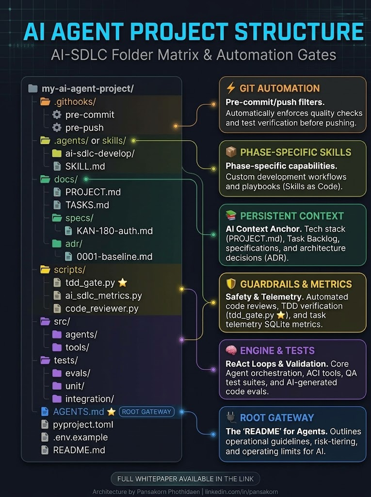

# AI Agent Project Scaffolding

[](https://github.com/pphothidaen/ai-agent-project-scaffolding/actions/workflows/guardrails.yml)
[](https://github.com/pphothidaen/ai-agent-project-scaffolding)
[](https://github.com/pphothidaen/ai-agent-project-scaffolding/generate)
[](https://opensource.org/licenses/MIT)
[-0077B5?logo=linkedin)](https://th.linkedin.com/in/pansakorn)

> **Author / Maintainer**: Pansakorn ([GitHub](https://github.com/pphothidaen) | [LinkedIn](https://th.linkedin.com/in/pansakorn))  
> **Source Repository**: [https://github.com/pphothidaen/ai-agent-project-scaffolding](https://github.com/pphothidaen/ai-agent-project-scaffolding)

A production-grade scaffolding template and harness for building autonomous AI agents with deterministic guardrails, TDD-first workflows, and boundary enforcement.

<p align="center">
  
</p>
<p align="center"><em>AI-SDLC Folder Matrix &amp; Automation Gates — architecture by Pansakorn Phothidaen</em></p>

---

## 🌟 Key Features

- **Root Operating Boundaries (`AGENTS.md`)**: Enforces explicit sandbox limitations, strict structured outputs, and risk-tiering (Autonomous vs. HITL).
- **Automated Guardrail Scripts (`scripts/`)**: Real-time inspection for secret leaks, directory access violation, and TDD compliance.
- **Enforced Git Hooks (`.githooks/`)**: Pre-commit and pre-push hooks running guardrail verification on every developer and agent operation.
- **Verifiable Testing & Evals (`tests/`)**: Built-in support for unit, integration, and LLM-driven evaluation suites.
- **GitHub Actions CI (`.github/workflows/guardrails.yml`)**: Cloud-grade automated pipeline ensuring gates pass on every pull request.

---

## 📂 Directory Layout

The diagram above maps each folder to its role (Git automation, phase-specific skills, persistent context, guardrails & metrics, engine & tests, root gateway). Full tree:

```
ai-agent-project-scaffolding/
├── .github/
│   └── workflows/
│       └── guardrails.yml    # Automated CI verification workflow
├── .githooks/                # Pre-commit & pre-push guardrail hooks
│   ├── pre-commit
│   └── pre-push
├── .agents/                  # Agent skills and behaviors
│   ├── ai-sdlc-develop/
│   │   └── SKILL.md
│   └── rules/                # Intake, developer, reviewer & deep/surface boundary rules
├── docs/                     # Architectural anchors and specifications
│   ├── PROJECT.md
│   ├── TASKS.md
│   ├── assets/
│   │   └── ai-agent-project-structure.jpeg
│   ├── specs/
│   │   └── KAN-180-auth.md
│   └── adr/
│       └── 0001-baseline.md
├── scripts/                  # Guardrail & metric evaluation scripts
│   ├── tdd_gate.py
│   ├── ai_sdlc_metrics.py
│   ├── code_reviewer.py
│   ├── audit_5layer.py
│   └── jira_label_gate.py
├── src/                      # Production agent & tool implementations
│   ├── agents/
│   │   └── base.py
│   └── tools/
├── tests/                    # Test & evaluation suites
│   ├── evals/
│   ├── unit/
│   │   └── test_base_agent.py
│   └── integration/
├── AGENTS.md                 # Root gateway & operating boundaries
├── pyproject.toml            # Project dependencies & configurations
├── Makefile                  # Developer workflow automation
├── bootstrap.sh              # Quickstart bootstrap script
├── LICENSE                   # MIT License
├── .env.example              # Environment variables template
└── README.md
```

---

## 🚀 Quick Start

### 1. Initialize from Template
Create a new agent repository using this template:
```bash
gh repo create my-agent-project --template pphothidaen/ai-agent-project-scaffolding
cd my-agent-project
```

### 2. Setup Environment & Hooks
Run one command to configure git hooks and dependencies:
```bash
make init
# or directly run:
# bash bootstrap.sh
```

### 3. Verify Guardrails & Gates
```bash
make check
```

---

## 🛡️ Operating Boundaries (Summary from `AGENTS.md`)

1. **Risk Tier 1 (Autonomous)**: Formatting, unit test generation, documentation updates.
2. **Risk Tier 2 (Audit Log)**: Core logic implementation conforming strictly to existing ADRs.
3. **Risk Tier 3 (Human-in-the-Loop Required)**: Schema updates, external API mutations, and infrastructure adjustments.

---

## 📜 License

Distributed under the [MIT License](LICENSE). Copyright (c) 2026 Pansakorn.
